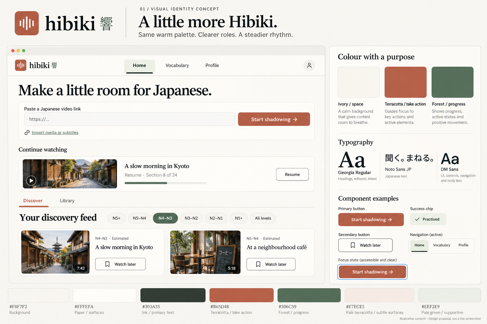
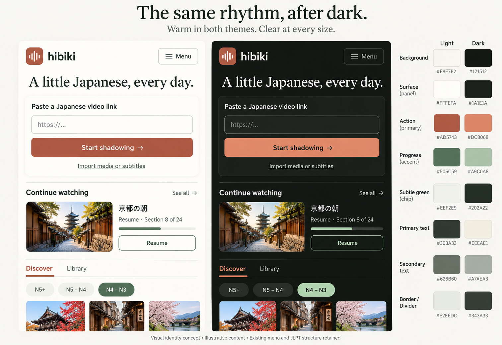

# Hibiki — visual identity, stage 01

Status: **proposed for discussion**, 20 October 2026. This package establishes a visual guideline; it does not change the running application.

## Start with the boards

These are generated concept images, not screenshots or verified responsive implementations. Lesson names, thumbnails, positions and counts are illustrative. Use the exact values and rules below rather than sampling image pixels.

**Image corrections:** The desktop board renders the wordmark in a serif face and gives some interface headings too much serif emphasis. Preserve the current DM Sans wordmark and waveform mark. Use Georgia only for major editorial headings, and DM Sans for section headings, card titles and controls. The mobile board is a visual comparison, not a measured 390px layout; it shows only part of the JLPT filter row. All existing level options remain available. The pale-border hex label in that image is approximate; the specified value is `#E6E6DD`. Images may show gradients, shadows or a blue focus ring; the specified system uses flat fills, restrained panel shadows and theme-aware focus tokens.

## The direction

Make the current warm Japanese listening space more recognisable through repeatable decisions. Keep ivory, terracotta and forest green, the waveform, the serif/sans contrast, Japanese-first content and the quiet tone.

The change is primarily consistency: the same action should look like the same action on Home, Discover, Library, Vocabulary, Profile and Practice. Branding should help someone find their next sentence, not compete with the video.

## Evidence and scope

Reviewed the public Home page at https://hibikiapp.net on 20 October 2026 and source at commit `b8457dbe92ea82581771a730ddd2bb2ad1f041de` in JulianPJ/Shadowing. The live page displayed an account age-confirmation dialog; no age assertion or account change was made. Inspection was limited to the visible Home shell plus repository sources; no complete live player, authenticated progress or mobile interaction audit is claimed.

Source references:
- [Product context](../../../PROJECT_CONTEXT.md): Japanese-first shadowing, calm UI, useful feedback over fake precision.
- [Base palette and controls](../../../src/app/styles/base.css)
- [Dark theme](../../../src/app/styles/theme.css)
- [Readability overrides](../../../src/app/styles/ux-polish.css): effective light secondary text is already `#626B60`, rather than the earlier base value.
- [Header and navigation](../../../src/components/chrome.tsx)
- [Discover styles](../../../src/app/styles/discover.css)
- [Home typography](../../../src/app/styles/home-import.css)
- [Architecture](../../architecture.md)

Current top-level sections are intentionally Home, Vocabulary and Profile; Discover and Library are tabs inside Home. The earlier conversation's suggestion of five destinations is a future proposal, not a diagnosis of accidental duplication. This stage retains the current structure so the identity can be assessed separately.

## Give the colours repeatable jobs

| Role | Light | Dark | Use |
| --- | --- | --- | --- |
| Canvas | `#F8F7F2` | `#121512` | Page background |
| Paper | `#FFFEFA` | `#1A1E1A` | Inputs, cards, menus |
| Primary text | `#303A33` | `#EEEAE1` | Japanese, titles, labels |
| Secondary text | `#626B60` | `#A7AEA3` | Metadata and supporting copy |
| Brand terracotta | `#B65D48` | `#DC8068` | Recognisable brand accent |
| Action fill | `#AD5743` | `#DC8068` | Principal filled button |
| Action text | `#FFFFFF` | `#121512` | Text on action fill |
| Action hover | `#9F4E3B` | `#ED9279` | Hovered action |
| Terracotta tint | `#F7ECE5` | `#2B201C` | Subtle saved/selected context |
| Forest | `#506C59` | `#A9C0A8` | Progress, completed practice, selected filters |
| Forest tint | `#EEF2E9` | `#202A22` | Progress support and current location |
| Quiet divider | `#E6E6DD` | `#343A33` | Nonessential separators |
| Control border | `#7A8377` | `#747C73` | Input boundaries when needed for recognition |
| Focus | `#506C59` | `#A9C0A8` | 3px outline, 3px offset |

Terracotta guides the next major action. Green makes state and progress visible. Ivory carries the content. Do not paint every section a different accent or introduce rainbow JLPT levels.

Use a single dominant filled action per immediate task region. Secondary actions are outlined or underlined. A full-page view can contain multiple independent regions; this is hierarchy guidance, not a literal one-button-per-page rule.

Selected navigation and filters need an underline, tick, weight or explicit state in addition to colour. Labels remain essential: a green dot alone must not mean “practised”.

Recording and errors need independent meaning. A recording state says **Recording** with a microphone indicator and stop action. An error names the problem and recovery, rather than merely recolouring the panel. Do not reuse the calm green success treatment for a recording in progress.

## A small contrast adjustment

Calculated sRGB contrast ratios for solid colour pairs:

| Pair | Ratio | Decision |
| --- | --- | --- |
| Current cream `#FFF9F4` on `#B65D48` | 4.33:1 | Below the 4.5:1 target for normal button labels |
| Proposed white on `#AD5743` | 4.98:1 | Darken the action fill slightly; retain brand terracotta elsewhere |
| Light secondary on canvas | 5.16:1 | Keep current readability override |
| Forest on forest tint | 5.10:1 | Readable labelled chips |
| Current cream `#FFFEFA` on dark accent `#DC8068` | 2.84:1 | Avoid for normal button text |
| Proposed dark `#121512` on `#DC8068` | 6.42:1 | Use dark button labels in dark mode |
| Dark secondary on paper | 7.41:1 | Keep |

These are token-pair calculations, not an accessibility certification. Opacity, imagery, disabled styling and rendered focus states require later browser verification. Quiet dividers are not intended to serve as the sole boundary of an interactive control.

## Type and rhythm

- **Brand:** existing lowercase DM Sans semibold wordmark, existing waveform mark and optional small 響. Do not adopt the generated desktop board's serif logo.
- **Editorial headline:** existing Georgia regular, 40–48px desktop, 30–34px mobile, line height 1.15–1.25. Use sparingly on Home and major empty states.
- **UI:** existing DM Sans; 24–28px page titles, 18–22px section headings, 16–18px card titles, 14–16px controls/body, 12–13px supporting metadata.
- **Japanese:** existing Noto Sans JP; 24–32px current practice sentence with approximately 1.75 line height; 16–18px transcript text. Preserve furigana space and wrapping; do not squeeze Japanese to fit a fixed-height card.
- **Spacing:** 4/8/12/16/24/32/48/64px. Keep related labels close to their control and leave more room between task groups.
- **Shape:** 8px controls, 12px content panels, pill-shaped level filters. A waveform logo may retain its current softer corner. Avoid forcing video surfaces or every component into the same radius.
- **Density:** content-led. A returning learner should see their way back into a lesson without scrolling through a decorative hero.
- **Icons:** retain Lucide at one consistent stroke weight; labels accompany unfamiliar actions.
- **Motion:** 120–180ms state transitions; respect reduced motion. No ornamental animated waveform while idle.

## Apply the identity without redesigning every task

| Surface | Identity application | Defer to later stage |
| --- | --- | --- |
| Home | Warm editorial heading, terracotta start action, clearly labelled resume state | Personalised dashboard composition |
| Discover | Keep JLPT bands, existing filters and video imagery; consistent forest selected states, quieter card chrome | Any new browsing layout |
| Library | Same card language; unambiguous saved and resume labels | Destination separation |
| Vocabulary | Japanese term first, source context visible, labelled Learning/Known states | Review interaction redesign |
| Profile | Green for observed learning activity; factual encouraging copy | Progress and reward mockups |
| Practice | Japanese is the strongest text; media remains central; consistent action/state styling | Listen → Speak → Compare hierarchy exploration |

JLPT remains an estimated content level when derived from analysis. Keep the real band ranges and the distinction between analysed and unanalysed content. Do not turn content difficulty into a claim that the learner has passed a JLPT level.

## Component behaviour to carry into implementation

- Primary: flat action fill, contrasting text; hover darkens in light mode and lightens in dark mode.
- Secondary: paper/transparent fill, visible border or underlined text; no competing solid accent.
- Selected filter: forest fill and matching theme text, `aria-pressed` or appropriate native selected state.
- Current location: forest tint, text weight plus underline, `aria-current`.
- Focus: 3px theme-aware outline with offset; verify it against adjacent surfaces.
- Loading: preserve button width, use a labelled busy state such as “Preparing…”, avoid replacing the whole page.
- Empty: explain the next useful step; zero activity is a beginning, not a failure.
- Error: preserve input and provide retry/import options when applicable.
- Disabled: do not blanket-dim entire panels; keep explanatory text readable.
- Mobile: controls at least 44px high, readable labels, no loss of Japanese text on zoom or long titles.

## What to assess in this stage

1. Does this still feel like Hibiki?
2. Do terracotta actions and green states feel coherent across themes?
3. Is the serif/sans balance calm without feeling like an article?
4. Are you comfortable using the existing colours more deliberately before exploring new layouts?

## Implementation handoff

`identity-tokens.json` is a proposed specification, not an imported runtime theme. The existing CSS cascade has later overrides; implementation must inspect these rather than replacing base.css in isolation. Reuse current fonts and icons; no new network dependency or backend work is required for this stage.

First consolidate action, surface, text and state tokens. Then apply them to shared chrome/controls and one representative page before extending to all surfaces. Verify the real app at desktop and mobile widths, both themes, keyboard focus, 200% zoom, long Japanese, furigana and media/recording continuity.

No application code has been modified or deployed here. The repository's runtime checks apply when implementation starts; this documentation-only proposal uses asset, link and colour-pair verification.

## Continue the same design record

| Stage | Focus | Status |
| --- | --- | --- |
| 01 | Visual identity, themes and component language | Proposed here |
| 02 | Personalised Home and separation of destinations | Suggested next |
| 03 | Rewarding progress and tracking | Pending |
| 04 | Practice hierarchy with current/proposed comparison | Pending; exploratory because the user is unconvinced |
| 05 | Discover refinements retaining JLPT | Pending |

Keep subsequent outputs under `docs/design-exploration/`, with dated decisions and links from its index. The current images are discussion material, not approved designs.
