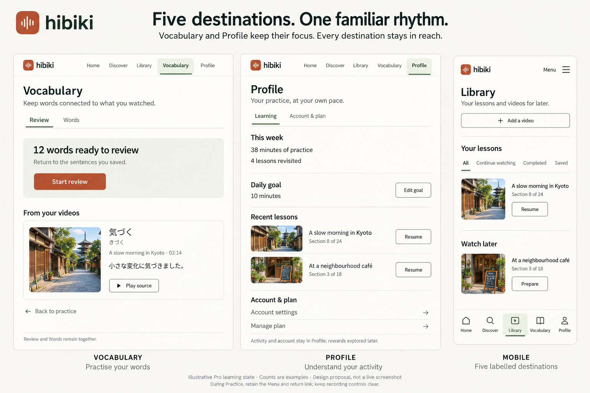

# Hibiki — clearer destinations, stage 02

Status: **proposed for discussion**, 20 October 2026. Continues [stage 01](../01-visual-identity/README.md) on PR #73. This is a design proposal, not an application implementation or an approved change to product context.

## Start with the mockups

The original composite did not demonstrate full desktop proportions. Use the [desktop revision and layout contract](./desktop-revision.md) for the current desktop proposal.

[Original narrow-frame desktop composite — superseded for layout review](./destinations-desktop.png)

Generated concept images, not screenshots or measured responsive layouts. Titles, photographs, counts and lesson activity are illustrative. The written rules below take precedence over generated image drift. Stage 01's exact tokens, sans-serif wordmark and waveform remain the visual authority.

## Image corrections and fidelity limits

The corrections below describe the original composites. The revised desktop pages have their own [fidelity notes and validation](./desktop-revision.md#visual-authority-and-fidelity).

- The desktop image gives Discover and Library serif titles; keep those page titles in DM Sans as specified in stage 01. Georgia remains reserved for the Home editorial greeting.
- The desktop cooking card accidentally displays “N5–N3”; that is not an existing band. Use the actual **N5–N4** band for that illustrative card. All real filter bands remain unchanged.
- The mobile Watch later card accidentally shows “Section 3 of 18”; an unprepared queued video must show source/duration or preparation status, never a practice position. Its Prepare action is the intended behaviour.
- Profile's Learning / Account & plan labels illustrate possible in-page anchors, not a new tab implementation or a committed reorganisation. Existing sections and access remain authoritative.
- Mockup colours, button shading, icons and sizes are approximate. Use the exact stage 01 flat-fill tokens and existing Lucide icons. Desktop utilities are omitted for space; sign-in and theme controls remain required.
- The original boards are 1536 × 1024 presentation composites; each revised desktop image is a separate 1536 × 1024 landscape page. The phone is a conceptual viewport, not a measured 390px capture. Touch sizes, label fit, safe areas, keyboard focus, dark mode and zoom still need implementation verification.

## The decision

Give five familiar nouns stable places: **Home · Discover · Library · Vocabulary · Profile**. The first three answer different questions:

- **Home:** What can I pick up now?
- **Discover:** What would I like to watch next?
- **Library:** Where is the lesson or video I already kept?

Vocabulary owns word practice; Profile owns the learning overview and account. Practice remains the working surface reached from content, rather than a sixth destination.

This trades a longer primary navigation for better visibility of finding and revisiting media. It also removes one layer of navigation for Discover and Library. The current three-section design is intentional, not a broken route setup. Five destinations are a proposal to assess against that compact alternative.

## What the source actually does today

At source commit `887dd3ec63fec4f4bd855c127ca820e814909037`:

- [Product context](../../../PROJECT_CONTEXT.md) explicitly groups Discover and Library within Home.
- [Shared chrome](../../../src/components/chrome.tsx) exposes Home, Vocabulary and Profile; Home is selected on `/`, `/discover`, `/library` and `/prepare`.
- [Home](../../../src/components/home.tsx) renders an intro/import region, a demo or Continue row, then Discover/Library route links.
- [Discover route](../../../src/app/discover/page.tsx) renders `<Home tab="discover" />`; [Library](../../../src/app/library/page.tsx) renders `<Home tab="library" />`.

This explains the shared composition. The proposal separates page ownership while reusing working functions. Live inspection was unavailable in this session; no claim is made about the complete current authenticated or mobile interface.

## One home for each task

| Destination | Existing route | Owns | Primary next action | Boundary |
| --- | --- | --- | --- | --- |
| Home | `/` | One useful resume item, compact review entry, bring-your-own-video entry, first-use demo | Resume, or Try the demo on first use | Links to Discover/Library rather than embedding their full feeds |
| Discover | `/discover` | Catalogue, search, all current JLPT bands and browsing filters, Watch later actions | Choose a video to prepare | No repeated Home hero, resume region or link-import form |
| Library | `/library` | Existing lessons, saved lessons, Watch later queue, add-video entry, media recovery | Resume, Revisit or Prepare, according to item state | No public catalogue or recommendation feed |
| Vocabulary | `/review`, `/words` | Existing Review and Words sub-navigation, source sentence/audio context | Start due review, or open a saved word | No new decks, tags or lesson collection concept |
| Profile | `/profile` | Existing weekly activity, daily goal, recent lessons, account/plan settings | Inspect activity or adjust account/goal | Detailed rewards exploration remains a later stage |

Home can preview a task without becoming its owner: a small “12 words due” entry points to Vocabulary; a “See your week” link points to Profile. Avoid reproducing a vocabulary manager or a full progress report on Home. The Home arrangement is only enough to explain this navigation proposal; deeper personalisation remains open.

## Desktop and mobile navigation

**Desktop:** keep the current horizontal header and brand. Five labelled links remain visible when they fit. Current location uses a forest tint, stronger weight and underline, plus `aria-current="page"`; colour alone is insufficient. Sign in and theme remain utilities. A signed-in account shortcut may point to Profile but must not create a separate account destination. No persistent sidebar is needed for five links.

**Compact widths:** use one fixed bottom navigation with all five labels and familiar outline icons. Labels are Home, Discover, Library, Vocabulary and Profile—no “More” destination. Each target is at least 44 × 44 CSS pixels. At 320px there is 64px nominal width per item before padding; at the specified 12px label size, Vocabulary needs an explicit font/zoom check. When the actual labels no longer fit at enlarged text or zoom, replace the bottom row with the existing labelled Menu and accessible dialog containing all five links. Never hide or abbreviate a destination to force the row to fit.

Use content fit to determine the header transition; a starting implementation breakpoint is 900px, to be checked with signed-out utilities and long labels. Do not display both desktop links and a second copy in the bottom bar. Add safe-area padding and page-bottom clearance; keyboard focus must never sit beneath the fixed bar. Theme/sign-in remain reachable from the compact header's utility menu.

**Practice:** keep the existing practice controls and player structure. Do not put a second bottom navigation over recording controls or the transcript. Retain the existing labelled Menu as the compact global escape, plus a contextual return link. Navigating away must pause playback and stop recording safely through the current lifecycle. Recordings and local object URLs must not be promised to survive unmount/reload.

## Keep the working sub-navigation

Promoting Discover and Library removes **only** their shared Browse strip inside Home.

| Page | Local navigation retained | Notes |
| --- | --- | --- |
| Discover | Level and content filters | Filters are not primary destinations |
| Library | All / Continue watching / Completed / Saved | Preserve meanings: Saved filters pinned lessons; Watch later is a separate unprepared-video queue |
| Vocabulary | Review / Words | One vocabulary model, no new collection structure |
| Profile | Existing activity and account sections | Keep account/plan reachable without inventing a sixth destination |

Discover retains all bands: **N5+, N5–N4, N4–N3, N3–N2, N2–N1, N1+, All levels**. Preserve the current suggested-level behaviour including unestimated content, and retain Topic, Duration, Speech speed, Captions, Sort, content orientation and variety. Wrap or horizontally scroll filter controls on small screens; never truncate the option set. Estimates describe content difficulty, not the learner's qualifications.

## Essential transitions

1. **Return and resume:** Home → Resume → existing `/practice/[id]` at the stored position. Library lists the same lesson and position; no second progress record.
2. **Discover and save:** Discover → Watch later → labelled confirmation with an Open Library link. The item appears in Library's Watch later queue; saving does not imply captions are prepared.
3. **Save and practise:** Library → Prepare on a queued video → `/prepare?video=…` → Practice after preparation. Preserve cancel, retry, imported-subtitle and demo fallbacks.
4. **Bring your own:** Home's compact link form and Library's Add a video both reuse the existing import/preparation workflow. Local media remains supported.
5. **Vocabulary detour:** Practice → Add to review → Vocabulary → Back to practice. Retain source sentence/timestamp and existing task-return semantics; do not show a second saved-word system.
6. **Inspect activity:** Home → See your week → Profile. Progress mockups in this stage only locate existing information.
7. **Browser return:** Discover → Practice → Back returns to the prior filter/scroll state. Library does likewise for its selected filter. Use URL state or session UI state without changing lesson storage keys.

## Routes and migration contract

Existing URLs stay valid; this is a composition/navigation change, not a route rename.

| URL | Proposed current destination / behaviour |
| --- | --- |
| `/` | Home |
| `/discover` | Discover |
| `/library` | Library |
| `/prepare` | Transient preparation workflow; return to originating destination, direct entry defaults to Home |
| `/review`, `/words`, `/dictionary` | Vocabulary, preserving the dictionary alias |
| `/profile`, `/progress`, `/account` | Profile, preserving aliases |
| `/practice/[id]` | Contextual Practice; explicit return to origin or Library when origin is unavailable |
| `/?bridge=import`, `/?video=…`, `/?subtitles=generate&video=…` | Keep existing Bridge and generated-subtitle handoffs working before showing the Home overview |

No primary destination should be marked current while a transient Practice page is active. Preparation uses a contextual origin link rather than pretending to be a new top-level section. Authentication return paths must still lead back to the task.

## States that define the separation

| Situation | Required behaviour |
| --- | --- |
| First visit / no history | Home leads with the existing demo and a concise explanation, then a link/import entry and Browse Discover; no fabricated review counts |
| Returning visitor | Choose the most recent resumable item; show a truthful loading state while device/account history hydrates |
| Zero due words | “You're up to date” with Open words, or omit the review preview; do not manufacture urgency |
| Empty Library | Explain lessons and Watch later separately; offer Try the demo, Browse Discover and Add a video |
| Filtered Library has no items | Name the selected filter and offer Show all; do not claim the whole Library is empty |
| Discover has no results | Preserve filters, explain the empty result and offer Clear filters |
| Discover temporarily unavailable / feature flag off | Keep Home and Library usable, offer own-media/demo fallback; honour the existing disabled route contract and omit unavailable navigation consistently |
| Missing local media | Keep the lesson/transcript visible and label Reattach file; no false Resume promise |
| Preparation fails | Keep the input and context; offer Retry, Import subtitles and Try the demo |
| Signed out / Free | Retain public viewing, imports and Watch later; preserve current Pro gates for active learning, review and detailed progress. Avoid showing Pro sample activity as real user data |
| Expired session | Reuse current actionable reauthentication treatment; no persistent technical sync dashboard |
| Long Japanese / large text | Wrap lesson titles and sentences naturally; controls stay labelled, usable and unobscured |

## Implementation handoff, when this proposal is approved

This stage deliberately edits no runtime source. A later implementation should:

1. Update `src/components/chrome.tsx` so navigation and current-route matching reflect the five destinations. Preserve utilities, mobile dialog semantics and due-count behaviour.
2. Split the current Home composition into focused page entry components; mount `DiscoverFeed` only on Discover and `LibraryTab` only on Library. Reuse the existing library hook rather than duplicating learner history or fetching a catalogue on Home.
3. Extract/reuse the existing bring-your-own/import/preparation controls; preserve URL, Bridge, Whisper-improvement and cancellation handoffs. Do not copy the entire Home component into each destination.
4. Keep `/prepare` a focused preparation surface with an origin-aware return. Preserve existing `task-return` and auth return-path contracts.
5. Apply [stage 01 tokens](../01-visual-identity/identity-tokens.json) to shared navigation and selected states. Inspect the existing CSS override order.
6. Preserve entitlements, storage keys, local-first anonymous use, media lifetime and silent sync. This proposal requires no new AI calls, databases or migration by itself.
7. Update the information architecture in `PROJECT_CONTEXT.md` and ownership in `docs/architecture.md` only when the implemented structure changes.

Runtime verification then follows `docs/architecture.md`: typecheck, lint, unit tests, format, build and relevant browser tests. Browser checks should cover every route/alias, direct entry and refresh, history/filter restoration, keyboard/dialog focus, both themes, 320px/390px/desktop, 200% zoom, Free/Pro/signed-out states, import fallbacks and safe practice exit. A generated board does not validate those behaviours.

## Review this stage

The proposed improvement is easier destination finding. The cost is a longer navigation and less browsing immediately below the Home intro. Assess whether you can locate a saved video and resume a lesson without guessing where they live.

Questions left for design feedback:

- Does giving Library and Discover their own header positions justify moving from three to five destinations?
- Does the mobile labelled bottom bar feel useful, with the existing menu retained for Practice and enlarged text?
- Is Home's compact resume/import focus enough, before a separate personalisation stage?

No user approval is inferred from continuing the design record. Next suggested stage: **personalised Home**, then rewarding progress, the practice-player comparison, or Discover refinements.
