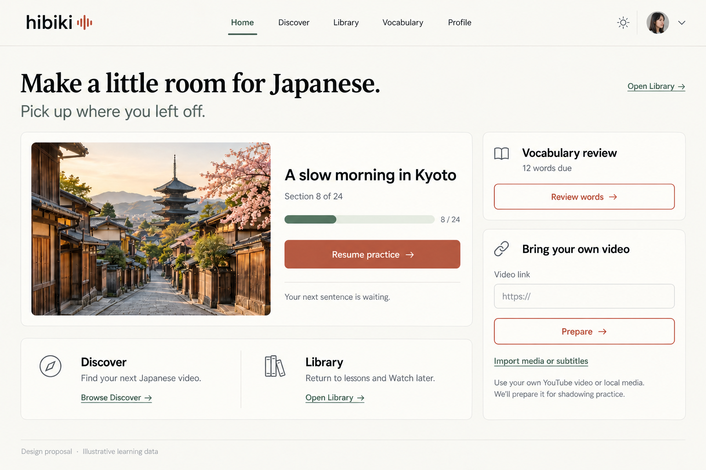
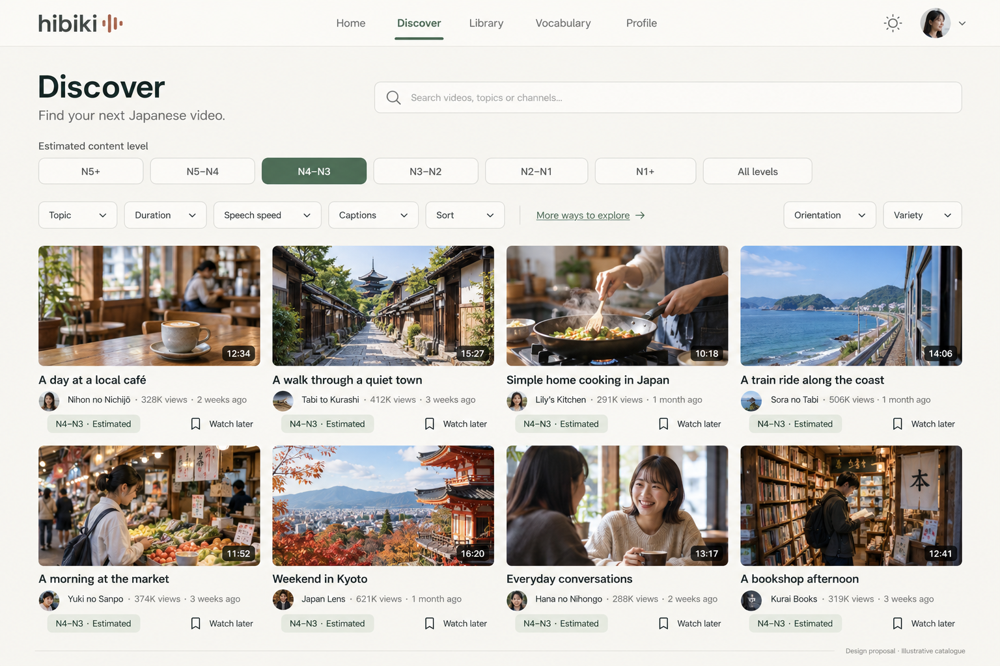
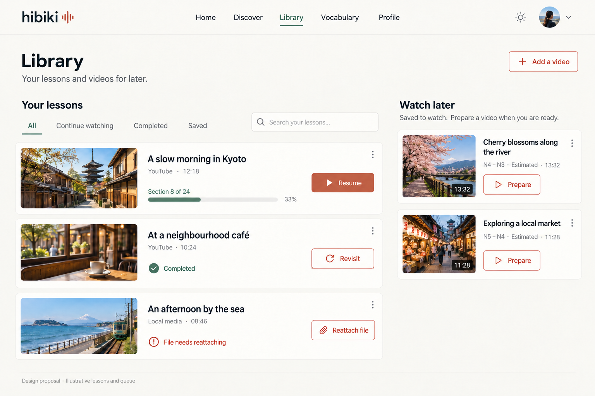

# Desktop revision — full-page destination views

20 October 2026. Proposed for discussion; generated concept images and documentation only.

## What the previous board missed

The original [desktop composite](./destinations-desktop.png) placed Home, Discover and Library next to one another on a single 1536 × 1024 presentation board. Visually inspecting it confirms that each page occupies a narrow portrait-shaped browser frame. Home stacks its tasks, Discover fits only two cards across and Library puts Watch later below lessons. The desktop header is present, but those proportions do not demonstrate a desktop workspace.

That is a limitation of the mockup, not evidence of a responsive defect in the running app. The mobile board intentionally explores compact screens. Stage 01 remains the palette/type specification; this revision supplies the missing broad desktop compositions.

## Revised desktop mockups

Each image is a separate **1536 × 1024 landscape page**, not three pages squeezed onto a board.

### Home

A horizontal resume feature occupies the main column. Review and bring-your-own-video controls sit together in a narrower right column. Discover and Library remain modest destination links below the resume feature, rather than full feeds.

The view is an illustrative returning Pro learner state. First use must lead with the demo and real available actions; it must not fabricate history or due counts. Resume refers to the existing lesson and stored position.

### Discover

Four video cards fit across, with two rows visible in the concept. Search, the complete difficulty row and secondary browsing controls occupy the width above the catalogue. Watch later remains a compact labelled action on each item.

The exact options are **N5+, N5–N4, N4–N3, N3–N2, N2–N1, N1+, All levels**. N4–N3 is selected and every illustrative result uses that estimated band. Topic, Duration, Speech speed, Captions, Sort, Orientation and Variety remain available. Estimates describe content, not learner certification.

### Library

Prepared lessons occupy the larger left region; the separate unprepared Watch later queue remains visible on the right. Lesson rows have room for a thumbnail, title, source, explicit progress/state and action without becoming tall cards.

All / Continue watching / Completed / Saved keep their existing meanings. Saved filters pinned lessons; it does not become Watch later. Resume, Revisit, Reattach file and Prepare correspond to different states. The queued items have estimated difficulty and duration, not a practice position.

## Composition contract for implementation

These are layout intentions, not measurements verified in a browser.

| Available space | Home | Discover | Library |
| --- | --- | --- | --- |
| Broad desktop, approximately 1280–1536 CSS px | Main region plus utility rail; horizontal resume composition | Four-column grid where readable card width permits | Lessons and Watch later side by side |
| Narrow desktop / tablet landscape | Move utilities below resume when the main content becomes cramped | Three or two columns as card width requires | Move Watch later below lessons when labelled actions no longer fit |
| Compact screens | Single reading order: resume/demo, review, import, destination links | One or two columns according to readable card width; filters wrap or scroll | Lesson list followed by Watch later |

Use a centred content area with a proposed maximum around 1280 CSS px, flexible gutters and minmax-based columns. Do not stretch a fixed four-column grid across ultrawide displays or retain two side panels when they become too narrow.

The five labelled header links, theme control and account/sign-in utility must fit together. Retain stage 02's content-fit transition to compact navigation and enlarged-text Menu fallback; do not shrink navigation labels to preserve the desktop shape. No fixed mobile bottom bar on the desktop views.

One DOM/content model should reflow rather than duplicating desktop and mobile task implementations. Preserve sensible reading and keyboard order when side content moves below the main region. Long Japanese, furigana and enlarged text must wrap naturally.

## Visual authority and fidelity

[Stage 01's exact tokens](../01-visual-identity/identity-tokens.json), existing DM Sans/Noto Sans JP fonts, sans-serif wordmark, waveform and Lucide icons remain authoritative. Georgia is reserved for the Home editorial greeting. Use exact flat action fills rather than sampling shaded pixels.

Generated photographs, avatars, channel names, views, lesson names, durations and activity are illustrative. No real catalogue provenance, account activity or availability is asserted. Logo geometry, type metrics, image colour, subtle button shading and pale control borders remain approximate; use the existing assets and specified tokens in implementation. The Library ellipsis controls illustrate contextual actions, not an approved new action menu.

These images do not demonstrate interactive filters, responsive CSS, accessibility, theme switching or working media. The existing mobile board remains a separate concept, with its documented limitations. Vocabulary/Profile desktop compositions and deeper Home personalisation remain future work.

## Validation

- Inspected the original destination board in the browser and confirmed the narrow portrait frames.
- Inspected all three new full-page landscape images and a bounded correction pass.
- Removed the generated Home kicker and serif lesson title; aligned the wordmark/waveform arrangement.
- Removed invented broadcaster names and generic difficulty claims from Library lesson metadata.
- Rejected a Discover correction that substituted individual JLPT levels and dropped controls; the retained asset restores all seven existing bands and all named browsing controls.
- Confirmed the final composition has five labelled desktop destinations, theme/account utilities, four-column Discover, and side-by-side Library regions.
- Verified PNG headers, committed paths, Markdown asset links and documentation-only change scope through GitHub.
- No application build/tests run: runtime code is unchanged. Later implementation still requires both themes, keyboard/focus, real route transitions, import/media lifecycle, 320px/390px/desktop and 200% zoom checks.
